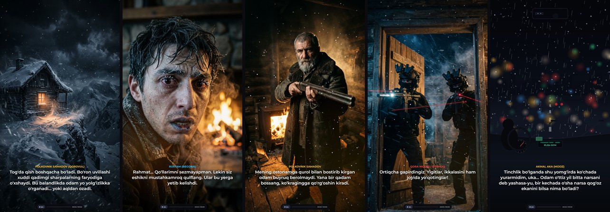
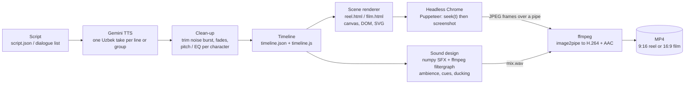
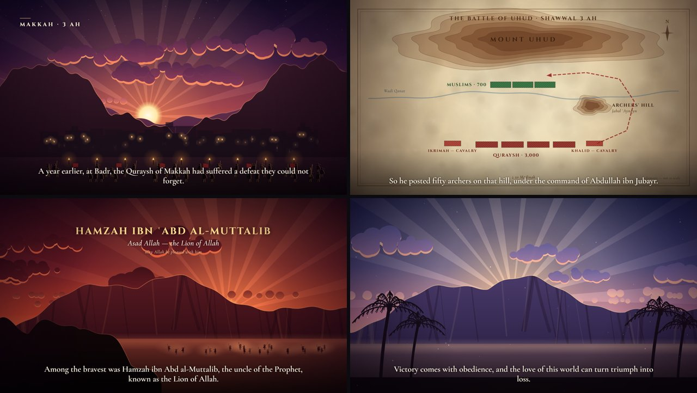
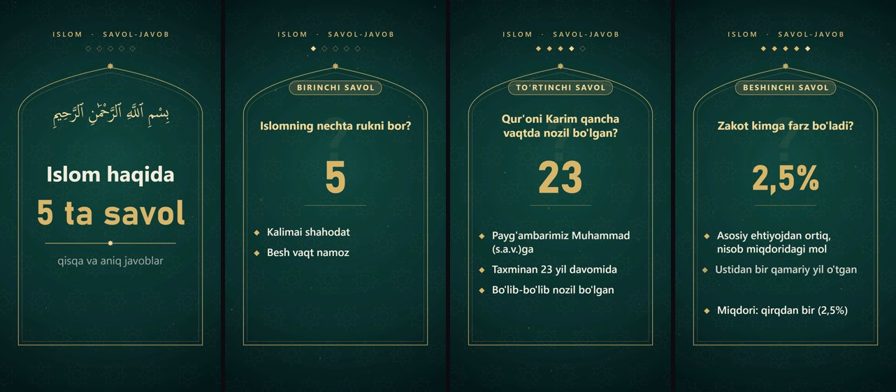
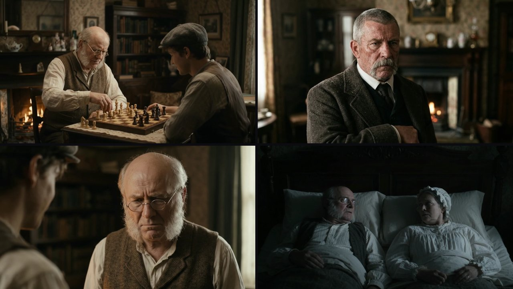
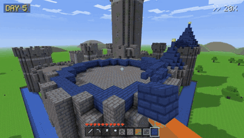
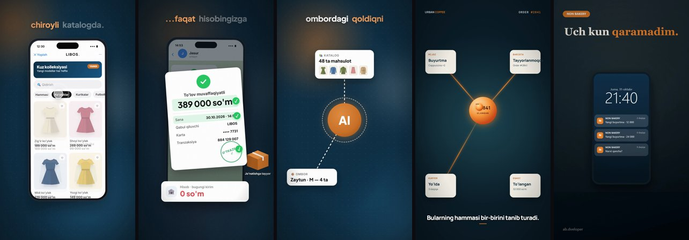

# AI Video Studio

**Sun'iy intellekt bilan o'zbek tilida video: ssenariydan tayyor MP4 gacha, hammasi kod orqali.**
*Uzbek-language video made with AI, from script to finished MP4, all in code.*

This repo holds the code behind my AI video projects: Uzbek audio-drama reels, an animated
history film, an Islamic Q&A explainer, a short film generated with Google Flow, a procedural voxel
timelapse, and Instagram reels for my **ab.dveloper** brand. None of them were made in a video
editor. Each video starts as a script and gets voiced, timed, animated, sound-designed and encoded by
scripts you can read and run again.

<p align="center">
  
</p>

## The pipeline

Most projects follow the same steps. The script is plain data (JSON or a Python list), the voice is
**Gemini TTS speaking Uzbek**, and the picture is an **HTML5 page** that can draw any moment of the
film on request. Headless Chrome steps through that page one frame at a time and **ffmpeg** encodes
the frames together with the mixed audio.



The ideas that make it work:

- **The timeline is generated from the audio.** Every voice clip is measured after synthesis, and its
  start and end times go into `timeline.js`. Subtitles, animations and sound cues all read those
  times, so the picture always matches the voice.
- **Rendering is deterministic.** The page exposes `seek(t)` / `renderAt(t)` and a `READY` promise.
  The renderer sets the time, takes a screenshot and pipes the JPEG straight into ffmpeg, so playback
  speed never affects the output.
- **Workarounds for Gemini TTS quirks.** A full-scale noise burst at the end of each clip gets cut
  off. When the model reads the style instruction aloud, that part is found and trimmed
  (`find_cuts.py`). Lines are grouped into one request where possible to save free-tier quota, then
  split again on the silences. When several API keys are set, the helper moves to the next key once
  one hits its daily limit.
- **Sound design is code.** Wind, rain, fire crackle, door knocks and gunshots are built with numpy
  and ffmpeg `anoisesrc`. The music bed is ducked under the voice with `sidechaincompress` and the
  whole mix is loudness-normalised with `loudnorm`.

Two projects take a different route. The Flow film uses AI video clips instead of HTML frames, and
the voxel timelapse renders with OpenGL in Python. See their READMEs.

## Gallery

| Project | Preview | What it is |
|---|---|---|
| [**uzbek-audio-series**](uzbek-audio-series/) |  | Uzbek mystery audio-drama reels (5 episodes across 3 stories, about 2.5–3 min each, 1080×1920) with Gemini-voiced characters and procedural sound design. |
| [**uhud-animated-film**](uhud-animated-film/) |  | A procedurally animated documentary about the Battle of Uhud, drawn on a canvas, with Uzbek and English narration. People appear only as faceless silhouettes. |
| [**islam-qa-video**](islam-qa-video/) |  | "Islom haqida 5 savol": a vertical Q&A explainer, narrated in Uzbek, with animated answer cards. |
| [**monkeys-paw-flow-film**](monkeys-paw-flow-film/) |  | W. W. Jacobs' *The Monkey's Paw*, retold with Uzbek dialogue: 32 shots generated in Google Flow from reference images and assembled with ffmpeg. |
| [**voxel-castle-timelapse**](voxel-castle-timelapse/) |  | A Minecraft-style castle build timelapse. The world, textures, camera story and sound effects are all generated in one Python + OpenGL script. |
| [**ab-dveloper-reels**](ab-dveloper-reels/) |  | Five Instagram reels for my ab.dveloper brand that show Telegram shop bots for small businesses, with animated phone UI, Uzbek voice-over and SFX cue sheets. |

## Repository layout

```
ai-video-studio/
├── uzbek-audio-series/      # shared/ (TTS helper + renderer) and one folder per episode
├── uhud-animated-film/      # canvas film, Uzbek + English narration, subtitles
├── islam-qa-video/          # vertical Q&A explainer
├── monkeys-paw-flow-film/   # Google Flow shot list, batch generator, editor
├── voxel-castle-timelapse/  # moderngl voxel renderer + story + synthesized SFX
├── ab-dveloper-reels/       # brand assets, TTS tools, video1..video5
├── docs/img/                # README images (contact sheets from the final renders)
├── package.json             # puppeteer-core, shared by every render.js
├── requirements.txt
└── .env.example
```

## Tech stack

- **Voice:** Gemini TTS (`generateContent` with an `AUDIO` response; voices Charon, Puck, Fenrir,
  Iapetus, Sulafat, Algenib), through AI Studio keys or Vertex AI. edge-tts is used for the English
  cut and one experiment.
- **Audio:** Python, numpy, ffmpeg filtergraphs (`anoisesrc`, `sidechaincompress`, `amix`,
  `alimiter`, `loudnorm`; character pitch shifts via `asetrate`).
- **Picture:** HTML5 Canvas 2D, CSS animation and SVG, rendered frame by frame with Puppeteer
  (`puppeteer-core` driving installed Chrome). moderngl (headless OpenGL) for the voxel film.
- **Video:** ffmpeg (`image2pipe` to libx264 + AAC, `concat`, `drawtext` titles, fades).
- **AI video:** Google Flow (Veo) with per-shot JSON prompts and character reference images.
- **Languages:** Python 3.10+, Node.js 20+.

## Run one project end to end

The episode `uzbek-audio-series/tungi-taksi-ep1` ("Tungi Taksi", a night-taxi drama with two
characters) uses the full pipeline and needs nothing but a Gemini API key.

```bash
# 0. one-time setup (repo root)
npm install                      # puppeteer-core (uses your installed Chrome)
pip install -r requirements.txt
cp .env.example .env             # put your GEMINI_API_KEYS in it
# set CHROME_PATH if Chrome is not at the default Windows path

cd uzbek-audio-series/tungi-taksi-ep1

# 1. voice: one Gemini TTS take per dialogue line -> audio/t01.wav ... (cached, safe to re-run)
python voice.py

# 2. timeline: measure every take, add dramatic pauses -> timeline.json, timeline.js, narration.wav
python assemble.py

# 3. sound design + master mix: rain, engine, wipers, radio, music ducked under speech -> mix.wav
#    (optional) SERIES_MUSIC=/path/to/track.mp3; without it a silent music bed is used
python mix.py

# 4. preview a few frames, then render the reel (1080x1920, 24 fps) -> tungi-taksi-ep1.mp4
cd ..
node shared/render.js tungi-taksi-ep1 stills 5,40,120
node shared/render.js tungi-taksi-ep1 video
```

`reel.html` also plays in a normal browser: it reads `timeline.js` and `mix.wav` from its own folder.

## What is not in this repo

The code, scripts, timelines and screenplays are all included. Large or third-party media are left out:

- Rendered videos (MP4) and all generated audio (TTS takes, narration, mixes). Re-run the scripts to
  create them.
- Music and SFX libraries (Mixkit downloads and similar). The scripts expect them in local `music/` /
  `sfx/` folders, and the per-project READMEs explain how.
- Flow clips and character reference images for the Monkey's Paw film, and the voxel film's
  multi-GB outputs.
- API keys. Every helper reads `GEMINI_API_KEYS` (or `GEMINI_API_KEY`) from the environment or
  from a `.env` file that git ignores.

## License

[MIT](LICENSE) © 2026 xoliddev
