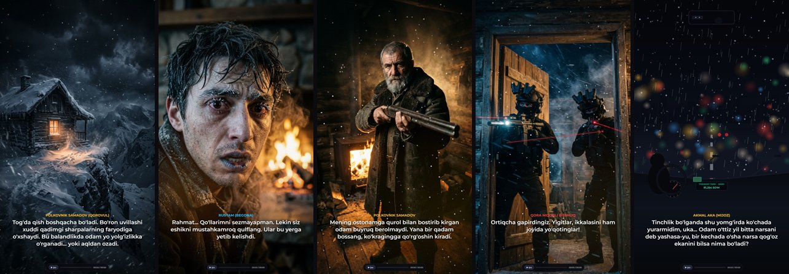
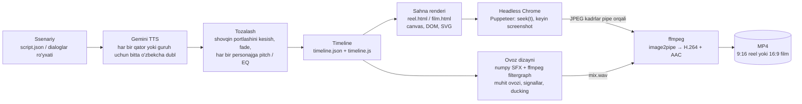
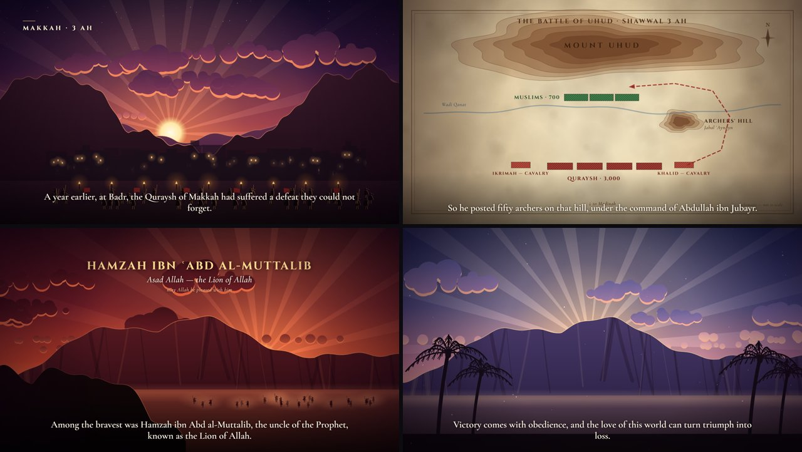
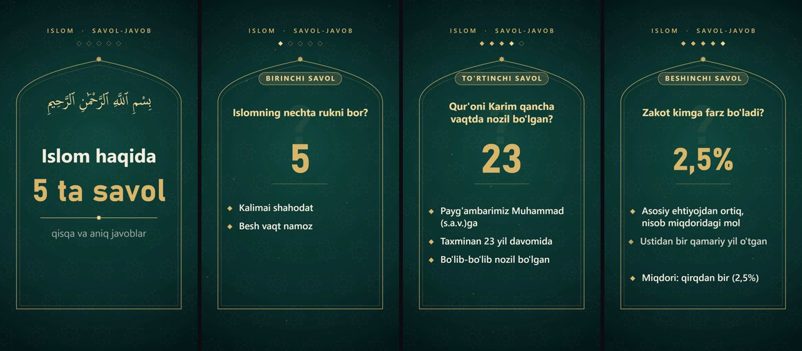
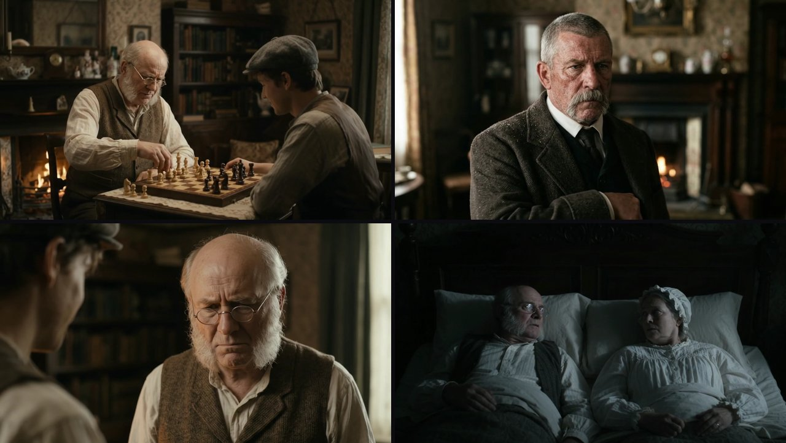
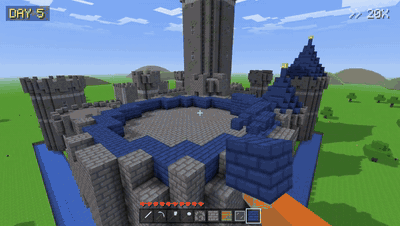
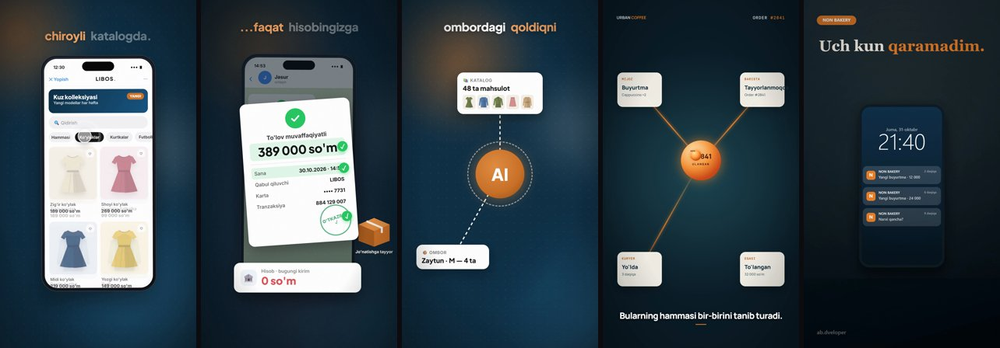

# AI Video Studio

[English](README.md) · **O'zbekcha**

[](https://xoliddev.github.io/demos/ai-video-studio/)

**Sun'iy intellekt bilan o'zbek tilida video: ssenariydan tayyor MP4 gacha, hammasi kod orqali.**
*Uzbek-language video made with AI, from script to finished MP4, all in code.*

Bu repoda AI video loyihalarimning kodi jamlangan: o'zbekcha audio-drama reels'lar, animatsion tarixiy
film, Islom haqida savol-javob videosi, Google Flow'da yaratilgan qisqa film, protsedural voksel
timelapse va **ab.dveloper** brendim uchun Instagram reels'lar. Ularning birortasi ham video muharrirda
yasalmagan. Har bir video ssenariydan boshlanadi, keyin uni ovozlash, vaqtga solish, animatsiya qilish,
ovoz dizayni va kodlash — bularning hammasini o'qib, qayta ishga tushirsa bo'ladigan skriptlar bajaradi.

<p align="center">
  
</p>

## Pipeline

Ko'pchilik loyihalar bir xil bosqichlardan o'tadi. Ssenariy oddiy ma'lumot (JSON yoki Python ro'yxati),
ovoz — **o'zbekcha gapiradigan Gemini TTS**, tasvir esa filmning istalgan lahzasini so'ralganda chiza
oladigan **HTML5 sahifa**. Headless Chrome shu sahifani kadrma-kadr aylanib chiqadi, **ffmpeg** esa
kadrlarni aralashtirilgan audio bilan birga kodlaydi.



Hammasini ishlatib turgan g'oyalar:

- **Timeline audiodan yaratiladi.** Har bir ovoz klipi sintezdan keyin o'lchanadi, uning boshlanish va
  tugash vaqtlari `timeline.js` ga yoziladi. Subtitrlar, animatsiyalar va ovoz signallari hammasi shu
  vaqtlarni o'qiydi, shuning uchun tasvir doim ovozga mos tushadi.
- **Render deterministik.** Sahifa `seek(t)` / `renderAt(t)` funksiyalari va `READY` promise'ini beradi.
  Renderer vaqtni o'rnatadi, screenshot oladi va JPEG'ni to'g'ridan-to'g'ri ffmpeg'ga uzatadi, shuning
  uchun ijro tezligi natijaga hech qanday ta'sir qilmaydi.
- **Gemini TTS injiqliklarini aylanib o'tish.** Har bir klip oxiridagi to'liq balandlikdagi shovqin
  portlashi kesib tashlanadi. Model uslub ko'rsatmasini ovoz chiqarib o'qib yuborsa, o'sha qism topilib
  kesiladi (`find_cuts.py`). Bepul limitni tejash uchun imkon qadar bir nechta qator bitta so'rovga
  jamlanadi, keyin pauzalar bo'yicha qayta bo'linadi. Bir nechta API kalit berilgan bo'lsa, birining
  kunlik limiti tugashi bilan yordamchi skript keyingisiga o'tadi.
- **Ovoz dizayni ham kod.** Shamol, yomg'ir, olov chirsillashi, eshik taqillashi va o'q ovozlari numpy
  va ffmpeg `anoisesrc` bilan yasaladi. Fon musiqasi `sidechaincompress` bilan ovoz ostida pasaytiriladi,
  butun miks esa `loudnorm` bilan balandlik bo'yicha normallashtiriladi.

Ikki loyiha boshqa yo'ldan boradi. Flow filmida HTML kadrlar o'rniga AI video kliplar ishlatilgan, voksel
timelapse esa Python'da OpenGL bilan render qilinadi. Ularning README'lariga qarang.

## Galereya

| Loyiha | Ko'rinish | Bu nima |
|---|---|---|
| [**uzbek-audio-series**](uzbek-audio-series/) |  | O'zbekcha sirli audio-drama reels'lar (3 ta hikoya bo'yicha 5 qism, har biri taxminan 2,5–3 daqiqa, 1080×1920): personajlarni Gemini ovozlagan, ovoz dizayni protsedural. |
| [**uhud-animated-film**](uhud-animated-film/) |  | Uhud jangi haqida canvas'da chizilgan, protsedural animatsiyali hujjatli film, o'zbekcha va inglizcha hikoya bilan. Odamlar faqat yuzsiz siluet ko'rinishida tasvirlangan. |
| [**islam-qa-video**](islam-qa-video/) |  | "Islom haqida 5 savol": o'zbekcha ovozli, animatsion javob kartalari bilan vertikal savol-javob videosi. |
| [**monkeys-paw-flow-film**](monkeys-paw-flow-film/) |  | W. W. Jacobsning *"Maymun panjasi"* hikoyasi, o'zbekcha dialoglar bilan qayta hikoya qilingan: referens rasmlar asosida Google Flow'da yaratilgan 32 ta kadr, ffmpeg bilan yig'ilgan. |
| [**voxel-castle-timelapse**](voxel-castle-timelapse/) |  | Minecraft uslubida qal'a qurilishi timelapse'i. Dunyo, teksturalar, kamera harakati va ovoz effektlari — hammasi bitta Python + OpenGL skriptida yaratiladi. |
| [**ab-dveloper-reels**](ab-dveloper-reels/) |  | ab.dveloper brendim uchun beshta Instagram reels: kichik bizneslar uchun Telegram do'kon botlarini ko'rsatadi, animatsion telefon UI'si, o'zbekcha ovoz va SFX signallar jadvali bilan. |

## Repo tuzilishi

```
ai-video-studio/
├── uzbek-audio-series/      # shared/ (TTS yordamchisi + renderer) va har bir qism uchun alohida papka
├── uhud-animated-film/      # canvas film, o'zbekcha + inglizcha hikoya, subtitrlar
├── islam-qa-video/          # vertikal savol-javob videosi
├── monkeys-paw-flow-film/   # Google Flow kadrlar ro'yxati, batch generator, montaj
├── voxel-castle-timelapse/  # moderngl voksel renderer + hikoya + sintez qilingan SFX
├── ab-dveloper-reels/       # brend materiallari, TTS vositalari, video1..video5
├── docs/img/                # README rasmlari (tayyor renderlardan olingan kontakt varaqlar)
├── package.json             # puppeteer-core, barcha render.js uchun umumiy
├── requirements.txt
└── .env.example
```

## Texnologiyalar

- **Ovoz:** Gemini TTS (`AUDIO` javobli `generateContent`; Charon, Puck, Fenrir, Iapetus, Sulafat,
  Algenib ovozlari), AI Studio kalitlari yoki Vertex AI orqali. Inglizcha versiya va bitta tajribada
  edge-tts ishlatilgan.
- **Audio:** Python, numpy, ffmpeg filtergraph'lari (`anoisesrc`, `sidechaincompress`, `amix`,
  `alimiter`, `loudnorm`; personajlar ovozining balandligi `asetrate` bilan o'zgartiriladi).
- **Tasvir:** HTML5 Canvas 2D, CSS animatsiya va SVG, Puppeteer bilan kadrma-kadr render qilinadi
  (`puppeteer-core` o'rnatilgan Chrome'ni boshqaradi). Voksel film uchun moderngl (headless OpenGL).
- **Video:** ffmpeg (`image2pipe` → libx264 + AAC, `concat`, `drawtext` sarlavhalar, fade'lar).
- **AI video:** Google Flow (Veo), har bir kadr uchun JSON prompt va personajlarning referens rasmlari bilan.
- **Tillar:** Python 3.10+, Node.js 20+.

## Bitta loyihani boshidan oxirigacha ishga tushirish

`uzbek-audio-series/tungi-taksi-ep1` qismi ("Tungi Taksi", ikki personajli tungi taksi dramasi) to'liq
pipeline'dan foydalanadi va unga Gemini API kalitidan boshqa hech narsa kerak emas.

```bash
# 0. bir martalik sozlash (repo ildizida)
npm install                      # puppeteer-core (o'rnatilgan Chrome'ingizdan foydalanadi)
pip install -r requirements.txt
cp .env.example .env             # ichiga GEMINI_API_KEYS ni yozing
# Chrome standart Windows yo'lida bo'lmasa, CHROME_PATH ni belgilang

cd uzbek-audio-series/tungi-taksi-ep1

# 1. ovoz: har bir dialog qatori uchun bitta Gemini TTS dubli -> audio/t01.wav ... (keshlanadi, qayta ishga tushirsa bo'ladi)
python voice.py

# 2. timeline: har bir dublni o'lchash, dramatik pauzalar qo'shish -> timeline.json, timeline.js, narration.wav
python assemble.py

# 3. ovoz dizayni + yakuniy miks: yomg'ir, motor, "dvorniklar", radio, gap ostida pasaytirilgan musiqa -> mix.wav
#    (ixtiyoriy) SERIES_MUSIC=/path/to/track.mp3; bo'lmasa jim musiqa fonidan foydalaniladi
python mix.py

# 4. bir nechta kadrni ko'rib chiqing, keyin reel'ni render qiling (1080x1920, 24 fps) -> tungi-taksi-ep1.mp4
cd ..
node shared/render.js tungi-taksi-ep1 stills 5,40,120
node shared/render.js tungi-taksi-ep1 video
```

`reel.html` oddiy brauzerda ham ochiladi: u `timeline.js` va `mix.wav` ni o'z papkasidan o'qiydi.

## Bu repoda nima yo'q

Kod, skriptlar, timeline'lar va ssenariylarning hammasi bor. Katta hajmli yoki uchinchi tomonga tegishli media qo'shilmagan:

- Render qilingan videolar (MP4) va yaratilgan barcha audio (TTS dublar, hikoya, mikslar). Ularni olish
  uchun skriptlarni qayta ishga tushiring.
- Musiqa va SFX kutubxonalari (Mixkit'dan yuklab olinganlar va shunga o'xshashlar). Skriptlar ularni
  lokal `music/` / `sfx/` papkalarida kutadi, buni har bir loyihaning README'si tushuntirib bergan.
- "Maymun panjasi" filmi uchun Flow kliplari va personajlarning referens rasmlari, shuningdek voksel
  filmning bir necha GB'lik natijalari.
- API kalitlar. Har bir yordamchi skript `GEMINI_API_KEYS` (yoki `GEMINI_API_KEY`) ni muhit
  o'zgaruvchilaridan yoki git e'tiborsiz qoldiradigan `.env` faylidan o'qiydi.

## Litsenziya

[MIT](LICENSE) © 2026 xoliddev
