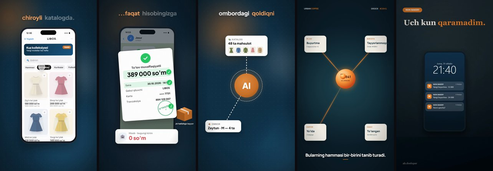

# ab.dveloper reels

*ab.dveloper brendi uchun Instagram reels: Telegram ichidagi do'kon botlari haqida qisqa videolar.*

Five vertical reels (1080×1920, 30 fps, 31–59 s) for my Instagram brand **ab.dveloper**. They show
what a Telegram shop bot does for a small business: the catalog, AI replies, payment checks and
orders. The phone screens, catalogs and order flows are all HTML/CSS/SVG animation driven by the
voice-over timeline.



| Folder | Reel | Idea |
|---|---|---|
| `video1` | *Do'kon Telegram ichida* | Instagram DMs pile up ("Narxi qancha?"), then the same clothing shop (LIBOS) runs as a Telegram catalog with colours, sizes, cart and payment |
| `video2` | *Soxta chek* | Fake payment screenshots vs. a bot that checks the payment itself |
| `video3` | *23:47. Kechasi ham sotadigan AI* | A customer's voice message at midnight gets answered by an AI seller that knows the stock |
| `video4` | *Bitta buyurtmaning sayohati* | One coffee-shop order as a particle of light travelling through the system: customer, barista, courier, paid |
| `video5` | *Uch kun* | A bakery owner is away for three days while the shop keeps taking and filling orders |

## Pipeline (video1–video4)

```bash
cd video1
python voice.py gen        # the script in 4 grouped Gemini TTS requests (voice Puck) -> audio/g1..g4.wav
python voice.py split      # split takes on silences -> per-line timings, narration.wav, timeline.json/.js
node render.js cues        # export the SFX cue sheet defined in reel.html -> sfx_cues.json
python mix_reel.py         # SFX bus from the cues + music (muffled until the "turn" line, then open,
                           # ducked under the voice) -> mix.wav
node render.js stills 1,5,9.5
node render.js video       # -> the reel mp4
```

`cover.html` lays out the reel cover (title kept inside the 1080×1440 band the profile grid
shows). `garments.js` draws the clothing items as SVG.

**video5** works differently. The voice comes from Vertex AI (`gemini-2.5-pro-tts`, Charon, a calm
documentary tone; set `GOOGLE_CLOUD_PROJECT` and log in with `gcloud`). `mix.py` builds a fully
procedural sound bed with no samples, and `finalize.py` ducks it under the narration and muxes the
final video.

## Folders

- `brand/`: logo and avatar (`logo.html`, `monogram.svg`, PNG exports and a preview sheet).
- `tools/gemini_tts.py`: Gemini TTS over `requests` with fast key failover.
  `probe_tts*.py` are small scripts that compare the TTS models on Vertex.

Music and SFX (Mixkit downloads, referenced by ID in `sfx_cues.json` and `mix_reel.py`) are not
redistributed. Put them in each video's `music/` and `sfx/` folders to rebuild the mix.
