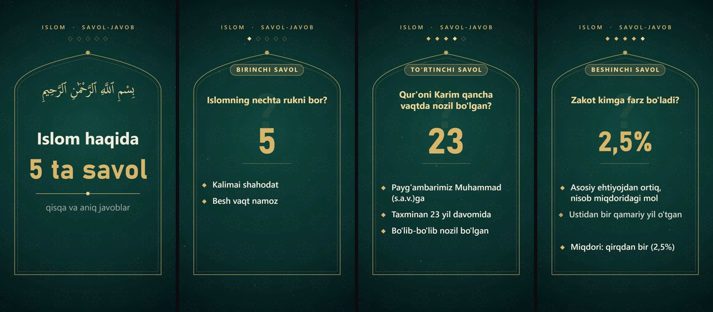

# Islom haqida 5 savol (Islamic Q&A)

*Islom haqida eng ko'p beriladigan beshta savolga qisqa va aniq javoblar.*

A vertical (1080×1920, 30 fps, about 1:39) explainer that answers five common questions: the
pillars of Islam, the pillars of faith, the daily prayers, how long the Qur'an took to be revealed,
and who must pay zakat. Each question appears on an arch-shaped card, then the answer animates in
as a large number and a bullet list, timed to the narration.



## How it works

- `script.json` holds each segment's spoken question (`ask`), answer, the large number (`big`),
  the bullet `items` and their `keys`, the words that reveal each bullet when they are spoken.
- `voice.py` sends **one Gemini TTS request per segment** (question and answer together) to stay
  within the free daily quota. It then finds the question/answer boundary as the longest pause in
  the clip, adds a beat of silence after each question, cuts the Gemini end-of-clip noise burst and
  writes `narration.wav` and `timeline.js`.
- `transcribe.py <model>` sends each take back to Gemini for a timestamped Uzbek transcript and a
  list of mispronounced words, as a quality check before rendering.
- `film.html` draws the cards on a canvas. `render.js` renders it frame by frame and
  loudness-normalises the narration while encoding.

## Run

```bash
python voice.py                                   # needs GEMINI_API_KEYS; takes cached in audio/
python transcribe.py gemini-2.5-flash             # optional pronunciation check (any Gemini model id)
FF=$(python -c "import imageio_ffmpeg;print(imageio_ffmpeg.get_ffmpeg_exe())")
node render.js "$FF" stills 3,20,40               # preview frames -> stills/
node render.js "$FF" video                        # -> islom_savol_javob.mp4
```
