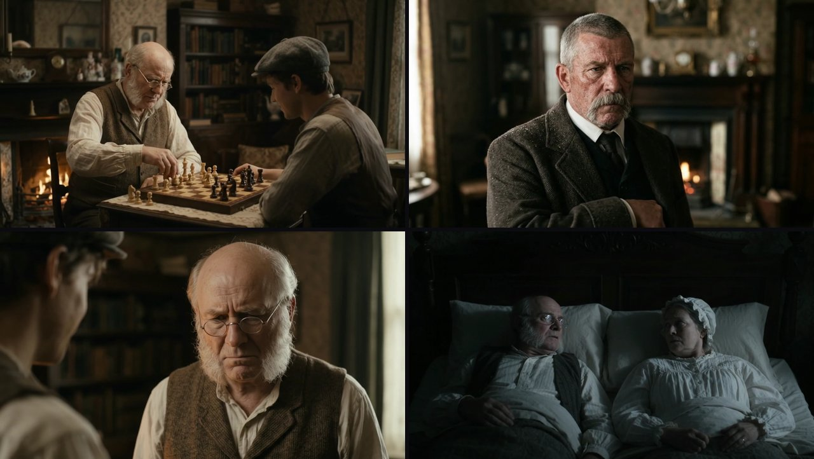

# Maymun panjasi (The Monkey's Paw)

*W. W. Jacobs hikoyasi asosida qisqa film: Google Flow'da yaratilgan kadrlar, o'zbekcha dialog.*

A short film (1280×720, 24 fps, about 4:45) based on W. W. Jacobs' 1902 story *The Monkey's Paw*,
which is in the public domain. It is set in England around 1902, and the characters speak Uzbek. All
32 shots were generated with **Google Flow** from text prompts plus character and location
reference images, then cut together with ffmpeg.




## Pipeline

1. **`screenplay.md`**: the script in Uzbek. It covers characters, locations and a shot table
   (number, length, action, dialogue), split into acts.
2. **`shots.py`** turns the shot list into `shots/NN.json` (`refs`, `duration`, `prompt`). Every
   prompt shares a style block (35 mm period-drama look, natural motion, consistent faces as in the
   reference images, no on-screen text, no music). Dialogue is written into the prompt in Uzbek so
   the lip movement matches the dub.
3. **`batch.py`** sends each shot that has no clip yet to Flow through `flowkit.cjs`, one at a time,
   logs the result, and stops after two failures in a row so it does not waste credits.
4. **`edit.py`** picks the newest take of each shot (`clips/NN_vK.mp4`). It normalises everything to
   24 fps 720p, adds fades at act breaks and at the end, draws the credit and the title
   (*MAYMUN PANJASI*) with `drawtext`, loudness-normalises the audio and writes `timeline.json`
   (shot, take, start, duration). With `--audio mix.wav` it swaps in a finished mix.
5. **`voices.py`** voices dialogue lines with Gemini TTS on Vertex AI, one voice per character
   (Iapetus, Sulafat, Puck, Algenib, Charon), for a separate dub track.

## Run

```bash
python shots.py                       # regenerate shots/*.json (refs/<name>.jpg, relative to this folder)
FLOWKIT=/path/to/flowkit.cjs python batch.py      # or: python batch.py 2 3 5
python edit.py                        # needs ffmpeg/ffprobe on PATH (or FFMPEG / FFPROBE)
UZTTS_DIR=/path/to/uz-tts-tool python voices.py --test
```

## Not included

- The Flow clips (`clips/`) and the reference images (`refs/`). Only the cast sheet above is
  shown. Both folders are git-ignored.
- `flowkit.cjs` (my Node driver for the Flow web app) and `uztts` (my Gemini/Vertex TTS helper) are
  separate tools. Set `FLOWKIT` and `UZTTS_DIR` to point to them.
