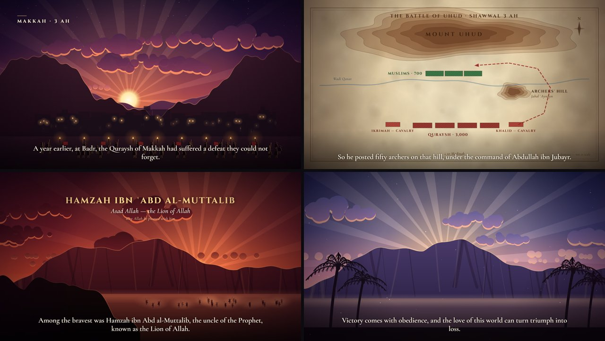

# Uhud: a story of patience and obedience

*Uhud — sabr va itoat qissasi. Hijriy 3-yildagi Uhud jangi haqida animatsion hujjatli film.*

A procedurally animated documentary about the Battle of Uhud (3 AH). Every frame is drawn in code on
an HTML5 canvas (`film.js`): dusk skies, Mount Uhud, the archers' hill, a battle map and title
cards. The narration is in Uzbek (Gemini TTS) and there is also an English cut.



**On depiction.** Following Islamic practice, people appear only as distant, faceless silhouettes.
The Prophet Muhammad (s.a.v.) and the named companions (r.a.), such as Hamza ibn Abd al-Muttalib
(r.a.), are never depicted. They are mentioned in the narration and in title cards only. The spoken
*sollallohu alayhi vasallam* is shortened to (s.a.v.) in the on-screen subtitles. The film uses no
music, only narration, a soft ambience bed and battle sound effects.

## Files

| File | Role |
|---|---|
| `script_uz.json` / `script_uz.md` | Uzbek narration by scene (voice Iapetus) |
| `script.json` / `script.md` | English narration. Arabic names are spliced in from a native Arabic voice (`{key}` placeholders) |
| `gemini_tts.py` | Gemini TTS helper (style prompt for Arabic pronunciation, key rotation) |
| `tts_uz.py` | Uzbek voice-over: synthesize (4 threads, cached) → trim → `narration.wav`, `timeline.js`, `subtitles_uz.srt`, `script_uz.md` |
| `find_cuts.py` | Gemini sometimes reads the style instruction aloud. This finds the pause after it and writes `audio_uz/cuts.json` |
| `tts.py` | English cut with edge-tts plus Arabic splices |
| `sfx.py` | Places battle SFX (charge, arrows, cavalry, falling standards) on the scene timeline → `sfx.wav` |
| `mix.py` | Narration + wind/drone ambience + SFX ducked under the voice (`sidechaincompress`) → `mix.wav` |
| `film.html` / `film.js` | The canvas film: `renderAt(t)` for any time `t`, plus a vertical layout per part |
| `render.js` | Puppeteer → JPEG frames → ffmpeg. Modes: `video` (16:9), `parts` (three vertical 9:16 episodes), `stills`, `vstills` |

## Run

```bash
pip install -r ../requirements.txt && (cd .. && npm install)
python tts_uz.py                 # needs GEMINI_API_KEYS; audio cached in audio_uz/
python find_cuts.py && python tts_uz.py   # only if some clips start with the spoken style prompt
python sfx.py                    # needs the Mixkit SFX mp3s in sfx/ (not included; free licence)
python mix.py                    # works without sfx.wav too (ambience only)

python -m http.server 8765       # render.js loads http://127.0.0.1:8765/film.html
FF=$(python -c "import imageio_ffmpeg;print(imageio_ffmpeg.get_ffmpeg_exe())")
node render.js "$FF" video       # -> uhud.mp4 (1920x1080, 30 fps)
node render.js "$FF" parts       # -> uhud_qism_1..3.mp4 (vertical parts for reels)
```

Open `film.html` through the same local server to watch it in a browser with a seek bar.
