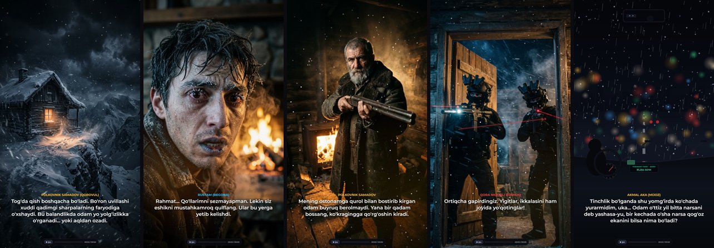

# Uzbek audio-drama series

*O'zbekcha audio-serial: sirli voqealar, ikki-uch ovozli dialog, kinematik ovoz dizayni.*

Vertical (1080×1920) mystery reels, about 2.5–3 minutes each. Each one is a dialogue between
Gemini-voiced characters, with subtitles, procedural sound design and either animated scenes or
AI-generated key art.



| Episode | Story | Voices | Length |
|---|---|---|---|
| [`togdagi-qorovulxona-ep1`](togdagi-qorovulxona-ep1/) | *Tog'dagi Qorovulxona: Qor Bo'roni*, ep. 1: a stranger knocks on an old watchman's mountain hut in a blizzard | Charon, Puck | 2:36 |
| [`togdagi-qorovulxona-ep1-remaster`](togdagi-qorovulxona-ep1-remaster/) | "Cinematic cut" of ep. 1: re-mastered takes, AI key-art shots, new sound design | Charon, Puck | 2:32 |
| [`togdagi-qorovulxona-ep2`](togdagi-qorovulxona-ep2/) | Ep. 2, *Ostonadagi To'qnashuv*: the armed men reach the door | Charon, Puck, Fenrir | 2:33 |
| [`tungi-taksi-ep1`](tungi-taksi-ep1/) | *Tungi Taksi: Oynadagi Yomg'ir*: a taxi driver and a passenger at 02:40 in the rain | Charon, Puck | 2:54 |
| [`sirli-yolovchi-ep1`](sirli-yolovchi-ep1/) | *Sirli Yo'lovchi*: a driver picks up a hitchhiker on an empty road | Charon, Puck | 2:55 |

## Layout

The five source folders were merged into one, and the code they all repeated now lives in `shared/`:

- `shared/gemini_tts.py`: text to a 24 kHz WAV through Gemini TTS, with rotation across several API
  keys.
- `shared/render.js`: one Puppeteer renderer for every episode
  (`node shared/render.js <episode> video|stills`). Before the merge, each episode had a copy that
  differed only in the output filename and CRF.

The other scripts stay with their episode because each one has its own dialogue, pauses, sound
cues and scene code (`voice.py`, `assemble.py`, `mix.py`, `reel.html`).

## Pipeline per episode

```bash
cd tungi-taksi-ep1
python voice.py        # DIALOGUE list -> audio/<id>.wav (Gemini TTS, cached)
python assemble.py     # measure takes + scripted pauses -> timeline.json / timeline.js / narration.wav
python mix.py          # numpy SFX + ffmpeg ambience + music ducked under speech -> mix.wav
cd .. && node shared/render.js tungi-taksi-ep1 video
```

Episode-specific steps:

- **ep1-remaster** reuses the episode 1 takes. `process_existing_audio.py` / `clean_ep1_audio.py`
  re-master them (watchman pitched down about 2.5 semitones, warm EQ, click-free cosine fades,
  removal of the Gemini end-of-clip noise burst) and `generate_q16.py` re-voices one line. After
  that, run `assemble_v2.py` and `mix_v2.py`. `reel.html` cuts between the AI key-art images in
  `shots/` (downscaled copies are included).
- **ep2** has two voice scripts: `voice_ep2_gemini.py` (Gemini, three characters) and
  `voice_ep2.py` (an edge-tts `uz-UZ-SardorNeural` experiment). After voicing, run
  `assemble_ep2.py` and `mix_ep2.py`.

## Media notes

- The music was a library track and is not included. Set `SERIES_MUSIC=/path/to/track.mp3` to
  add your own. Without it, `mix.py` uses a silent bed and everything else still renders.
- `ep1-remaster/mix_v2.py` uses an optional door-knock sample at `audio/sfx_door_pound.wav`. If the
  file is missing, the knock is skipped.
- Generated audio, `stills/` and the MP4 renders are git-ignored.
