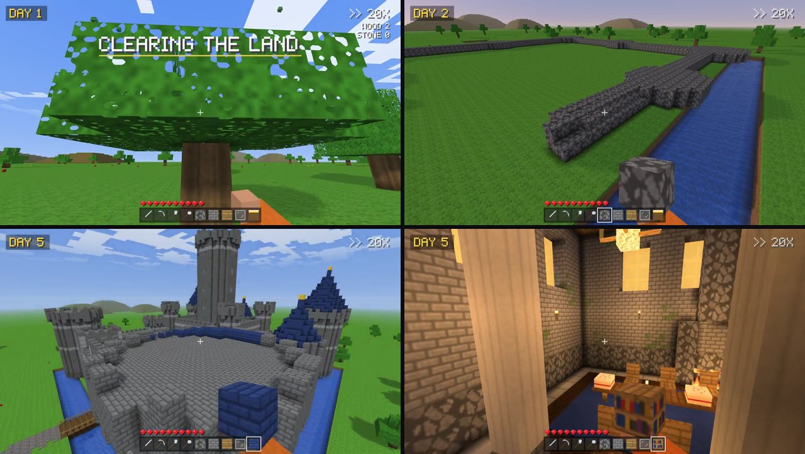

# Voxel castle build timelapse

*Minecraft uslubidagi qal'a qurilishi: dunyo, kamera hikoyasi va ovoz effektlari bitta Python skriptda.*

A first-person "five days of building a castle" timelapse in a Minecraft-style voxel world. There is
no game, no recorded footage and no downloaded asset. `castle_video.py` (about 2,900 lines) generates
all of it:



- **Textures:** 16×16 pixel-art textures painted in numpy (grass, stone bricks, planks, glass,
  ores, banners and more).
- **World and build:** terrain, trees, a moat, a keep, round and square towers with conical roofs,
  walls and a furnished interior. These are built as tens of thousands of block-placement events,
  ordered the way a player would place them.
- **Story camera:** a first-person player who chops trees, mines ores (wood, stone, coal, iron,
  diamond counters on the HUD), fights mobs at night, gets caught in a thunderstorm and ends with
  fireworks. Catmull-Rom camera paths, day and night, 20× speed-up captions and day cards (*Day 1: An empty
  field* through *Day 5: The final day*).
- **Rendering:** moderngl (headless OpenGL) with a light-propagation field for torch light,
  shadows and blended water and glass. Frames are piped straight into ffmpeg.
- **Sound:** every effect (swings, hits, mob groans, thunder, splash, door, chime, firework launch
  and boom) is synthesized in numpy and placed on the story timeline.

The full render is about 15 minutes at 30 fps (1920×1080 by default).

## Run

```bash
pip install numpy moderngl Pillow imageio-ffmpeg
python castle_video.py --preview 10,90,200          # PNG stills -> preview/
python castle_video.py --start 40 --end 60          # a short clip
python castle_video.py                              # full film -> epic_castle_build.mp4 (+ build/sfx.wav)
python castle_video.py --w 1280 --h 720 --out castle_720p.mp4
```

The renders are several hundred MB to about 1 GB, so they are not in the repo (`build/`, `preview/`
and `*.mp4` are git-ignored).
